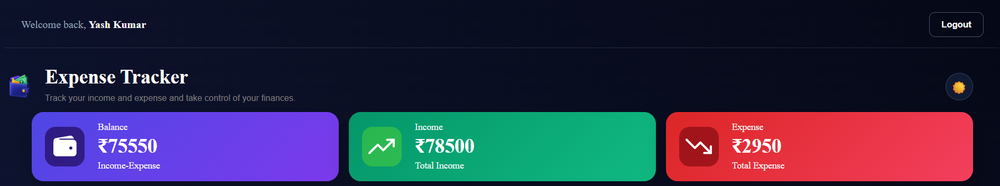
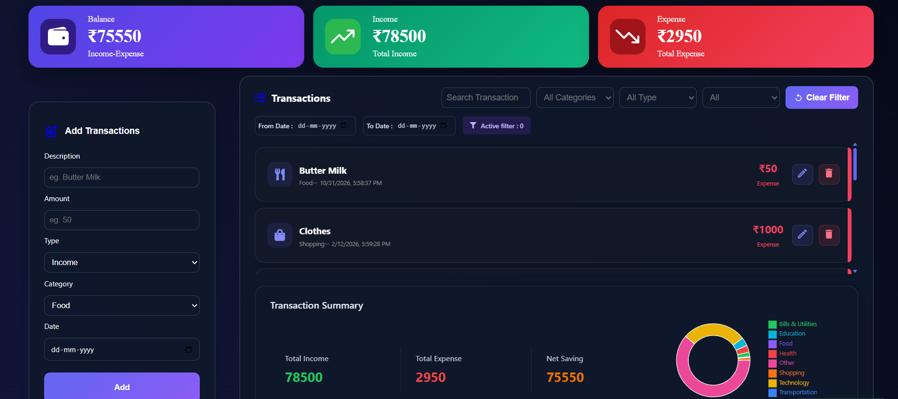
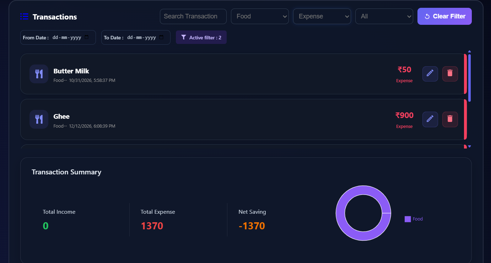
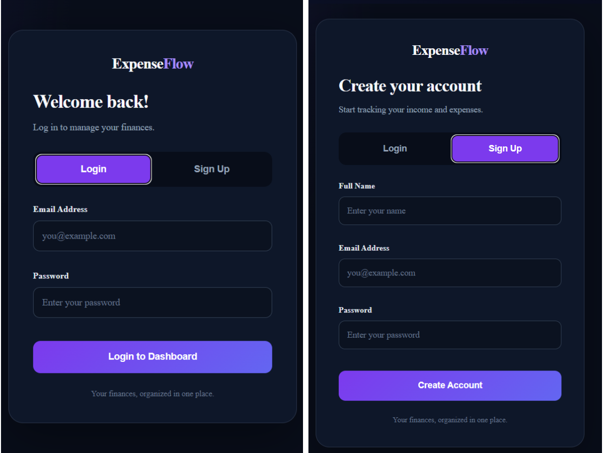

# 💰 Expense Tracker — ExpenseFlow

ExpenseFlow is a full-stack expense tracking application built using the MERN stack. It helps users manage their income and expenses, monitor their financial activities, and understand spending patterns through an interactive dashboard.

🌐 **Live Application:** https://expense-trackerv-2.netlify.app/

---

## 🚀 Live Demo

| Resource          | Link                                                      |
| ----------------- | --------------------------------------------------------- |
| Live Frontend     | https://expense-trackerv-2.netlify.app/                   |
| Backend API       | https://expense-tracker-dashboard-1-rm03.onrender.com/    |
| GitHub Repository | https://github.com/Yash-bot-max/expense-tracker-dashboard |

---

## ✨ Features

### 🔐 Authentication & Security

* User registration and login.
* JWT-based authentication.
* Secure HttpOnly cookie-based authentication.
* Protected API routes.
* Authentication persistence after page refresh.
* Secure logout functionality.
* User-specific transaction access.
* Password hashing using bcrypt.

### 💸 Transaction Management

* Add income and expense transactions.
* Edit existing transactions.
* Delete transactions.
* Store transaction details in MongoDB.
* Select transaction dates.
* Automatic date and time handling.

### 📊 Dashboard & Analytics

* Income, expense, and balance summary.
* Category-based expense visualization.
* Interactive pie/doughnut chart using Recharts.
* Monthly financial summary.
* Net savings calculation.

### 🔎 Search & Filtering

* Search transactions by description.
* Filter by transaction type.
* Filter by category.
* Filter by date.
* Sort transactions.
* Display active filter count.

### 🎨 User Interface

* Modern dark-themed dashboard.
* Responsive layout.
* Interactive UI components.
* Form validation.
* Success notifications.
* Empty states for unavailable chart data.

---

## 🛠️ Tech Stack

| Category            | Technologies                  |
| ------------------- | ----------------------------- |
| Frontend            | React.js, JavaScript, CSS     |
| Backend             | Node.js, Express.js           |
| Database            | MongoDB, Mongoose             |
| Authentication      | JWT, HttpOnly Cookies, bcrypt |
| Forms               | React Hook Form               |
| Charts              | Recharts                      |
| Icons               | React Icons                   |
| Notifications       | SweetAlert2, React Toastify   |
| HTTP Client         | Axios                         |
| Build Tool          | Vite                          |
| Frontend Deployment | Netlify                       |
| Backend Deployment  | Render                        |

---

## 📂 Project Structure

```text
expense-tracker-dashboard/
│
├── backend/
│   ├── controllers/
│   ├── middleware/
│   ├── models/
│   ├── routes/
│   ├── config/
│   ├── server.js
│   └── package.json
│
├── frontend/
│   ├── src/
│   │   ├── component/
│   │   ├── assets/
│   │   ├── App.jsx
│   │   ├── App.css
│   │   └── index.css
│   │
│   ├── public/
│   └── package.json
│
├── .gitignore
└── README.md
```

---

## ⚙️ Installation & Setup

Follow these steps to run ExpenseFlow locally.

### 1. Clone the Repository

```bash
git clone https://github.com/Yash-bot-max/expense-tracker-dashboard.git

cd expense-tracker-dashboard
```

### 2. Backend Setup

Navigate to the backend directory:

```bash
cd backend
npm install
```

Create a `.env` file inside the backend folder:

```env
PORT=4000
MONGO_URI=your_mongodb_connection_string
JWT_SECRET=your_secure_jwt_secret
NODE_ENV=development
```

Start the backend development server:

```bash
npm run dev
```

The backend will run at:

```text
http://localhost:4000
```

### 3. Frontend Setup

Open another terminal from the project root:

```bash
cd frontend
npm install
```

Start the frontend development server:

```bash
npm run dev
```

The frontend will typically run at:

```text
http://localhost:5173
```

**Note:** Make sure your frontend API configuration points to your local backend during development. Configure CORS to allow your local frontend origin.

### 4. Production Build

To generate an optimized frontend production build:

```bash
npm run build
```

The generated files will be available inside:

```text
frontend/dist/
```

---

## 🔒 Security Implementation

Security and user data isolation are important parts of ExpenseFlow.

* Passwords are hashed using bcrypt.
* JWT authentication is implemented using HttpOnly cookies.
* Authentication middleware protects private API routes.
* Transaction routes require authentication.
* Each transaction is associated with its authenticated user.
* Users can only view, update, and delete their own transactions.
* Unauthenticated users cannot access protected transaction APIs.

---

## 🧪 Testing

The following scenarios have been manually tested:

* User registration and login.
* Authentication persistence after refresh.
* Logout functionality.
* Adding, updating, and deleting transactions.
* User-specific transaction isolation.
* Unauthorized API access.
* Preventing one user from modifying another user's transactions.
* Live frontend and backend integration.

---

## 📸 Screenshots

### 1. Dashboard



### 2. Transaction Management



### 3. Analytics



### 4. Authentication



## 👨‍💻 Author

**Yash**

* GitHub: https://github.com/Yash-bot-max

---

## 📄 License

This project is developed for learning and portfolio purposes.
